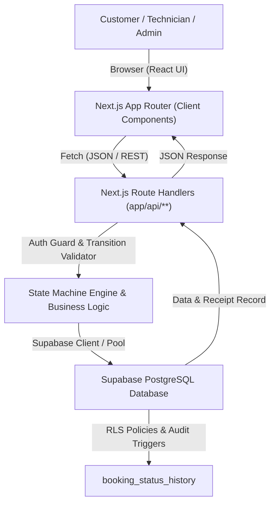

# FixMate – On-Demand Local Technician & Repair Service Platform
> **Course:** CSE 3292 Web Development Bootcamp  
> **Brand Name:** FixMate  
> **Tagline:** *"Your Home, Our Responsibility."*  
> **Architecture:** Full-Stack Next.js (App Router) + React.js + Tailwind CSS + Supabase (PostgreSQL) + REST API Handlers

---

## 1. Project Overview

**FixMate** is a modern, full-stack, on-demand home service marketplace connecting customers with verified local technicians (plumbers, electricians, AC mechanics, appliance specialists, painters, and carpenters).

FixMate solves the chronic issues of traditional handyman booking: uncertain pricing, unverified strangers entering homes, lack of warranties, and no real-time status tracking.

### Core System Pillars
1. **8-Stage Job Booking State Machine:** Enforces strict sequential status transitions from `booking_requested` to `completed`.
2. **Technician Dispatch Engine:** Allows administrative dispatchers or on-duty verified technicians to claim and fulfill service requests based on trade category and availability.
3. **Transparent Upfront Rate Cards:** Base diagnostic fees, standard labor charges, parts costs, and emergency surcharges are itemized transparently before confirmation.
4. **Warranty Tracking System:** Every finished service generates a formal digital warranty certificate (3 to 12 months) covering labor and installed parts.
5. **Digital Receipts & PDF Invoicing:** Automatic receipt generation with line-item breakdowns, printable layout, and verification codes.
6. **Triple-Role Portals:** Discrete, customized dashboards for **Customers**, **Technicians**, and **Administrators** with Role-Based Access Control (RBAC).

---

## 2. Technology Stack

| Layer | Technologies Used | Description |
|---|---|---|
| **Frontend Framework** | **Next.js 14+ (App Router)** | Server Components, Client Components, nested layouts, streaming |
| **UI Library** | **React.js 18+** | Reusable component hierarchy, Hooks (`useState`, `useEffect`, `useContext`) |
| **Styling & Design** | **Tailwind CSS 3** | Responsive grid, custom SaaS palette (#2563EB Deep Blue, #0F172A Dark Navy) |
| **Icons** | **Lucide React** | Clean, consistent SVG icon set |
| **Backend & APIs** | **Next.js Route Handlers (`app/api/**/route.js`)** | RESTful endpoints with input validation, HTTP status codes, JSON responses |
| **Database** | **Supabase & PostgreSQL** | Relational tables, Foreign Keys, UUIDs, Triggers, Indexes, Row Level Security (RLS) |
| **Auth & Security** | **Supabase Auth / Custom RBAC** | Password hashing, role guards, protected portal layouts |

---

## 3. Architecture & Data Flow



### How Frontend, Backend, and Database Work Together
1. **Frontend:** React Client Components render interactive UI widgets (5-step booking wizard, live milestone tracker, star rating modal). When a user takes an action, React fires an event handler.
2. **Backend:** The event handler issues an asynchronous `fetch()` HTTP request to Next.js API Route Handlers (`/api/bookings`, `/api/technicians`, etc.). The backend validates data types, checks authentication, and enforces the state machine.
3. **Database:** Supabase PostgreSQL executes queries with Row Level Security (RLS). A PostgreSQL trigger (`handle_booking_status_change`) automatically captures every status change in `booking_status_history` for an unalterable audit trail.

---

## 4. Folder Structure & Purpose

```
FixMate/
├── app/                              # Next.js App Router root
│   ├── layout.js                     # Root layout with AuthProvider & DatabaseBanner
│   ├── globals.css                   # Tailwind directives, animations & print styles
│   ├── page.js                       # Public landing page (Hero, Services, Testimonials, CTA)
│   ├── services/                     # Public services catalog with search & category filters
│   ├── about/                        # Mission, problem solved, and trust pillars
│   ├── contact/                      # 24/7 support inquiry form & hotline contacts
│   ├── login/                        # Authentication login page with quick demo accounts
│   ├── register/                     # Registration with Customer vs Technician selection
│   ├── forgot-password/              # Password recovery page
│   │
│   ├── customer/                     # CUSTOMER PORTAL
│   │   ├── layout.js                 # Customer sidebar navigation & header
│   │   ├── page.js                   # Customer dashboard overview & recent bookings
│   │   ├── book-service/             # 5-Step interactive booking wizard
│   │   ├── bookings/                 # Booking list, cancellation & status filters
│   │   │   └── [id]/receipt/         # Printable digital service receipt
│   │   ├── tracking/                 # Real-time 8-stage progress tracker
│   │   ├── reviews/                  # Customer feedback history & review rating modal
│   │   ├── complaints/               # Dispute filing and administrative redressal view
│   │   └── profile/                  # Customer profile and address management
│   │
│   ├── technician/                   # TECHNICIAN PORTAL
│   │   ├── layout.js                 # Dark technician sidebar & verification status
│   │   ├── page.js                   # Technician overview KPIs (Jobs, Earnings, Rating)
│   │   ├── requests/                 # Live incoming dispatch request pool (Accept/Decline)
│   │   ├── jobs/                     # Active repair management & status milestone stepper
│   │   ├── availability/             # Duty online/offline toggle & weekly schedule manager
│   │   ├── history/                  # Archive of finished services & recorded parts
│   │   ├── earnings/                 # Financial earnings, payout history & bank clearance
│   │   ├── reviews/                  # Client feedback received
│   │   └── profile/                  # Technician credentials, license & skills profile
│   │
│   ├── admin/                        # ADMIN PORTAL
│   │   ├── layout.js                 # Master operations console sidebar
│   │   ├── page.js                   # Executive overview with KPI cards & category charts
│   │   ├── dispatch/                 # Job dispatching center (match technician to booking)
│   │   ├── verification/             # Technician license & document approval queue
│   │   ├── bookings/                 # Comprehensive booking registry & audit controls
│   │   ├── technicians/              # Full technician roster & duty status toggle
│   │   ├── customers/                # Customer user database & spend analytics
│   │   ├── services/                 # Service catalog CRUD & rate card management
│   │   ├── pricing/                  # Rate card preview & transparent breakdown
│   │   ├── complaints/               # Dispute investigation & resolution responses
│   │   ├── warranties/               # Warranty tracking & expiry management
│   │   ├── reports/                  # Analytics & CSV export reports with date filters
│   │   └── settings/                 # System parameters & Supabase integration status
│   │
│   └── api/                          # REST API ROUTE HANDLERS
│       ├── services/                 # GET active services, POST new service
│       │   └── [id]/                 # GET single service, PATCH service rates
│       ├── technicians/              # GET technicians with category & status filters
│       │   └── [id]/                 # GET single technician, PATCH profile
│       │       ├── verify/           # PATCH approval / rejection with remarks
│       │       └── availability/     # PATCH toggle online / offline duty status
│       ├── bookings/                 # GET customer/technician bookings, POST create booking
│       │   └── [id]/                 # GET booking details, DELETE cancel booking
│       │       ├── status/           # PATCH advance state machine & record service details
│       │       └── dispatch/         # POST assign verified technician to booking
│       ├── complaints/               # GET complaints, POST lodge complaint
│       │   └── [id]/                 # PATCH record admin response & resolve dispute
│       ├── reviews/                  # GET reviews, POST star rating for completed job
│       ├── warranties/               # GET active warranty certificates
│       ├── receipts/[id]/            # GET digital receipt for booking
│       └── stats/                    # GET platform aggregate KPI metrics
│
├── components/                       # REUSABLE REACT COMPONENTS
│   ├── common/                       # Navbar, Footer, StatusBadge, Modal, DatabaseBanner
│   ├── customer/                     # BookingWizard, ServiceTracker, ReceiptView, ReviewModal
│   ├── technician/                   # JobCard, ServiceRecordModal, AvailabilityToggle
│   └── admin/                        # StatsCard, DispatchModal, TechnicianApprovalModal
│
├── lib/                              # APPLICATION CORE UTILITIES
│   ├── supabase/                     # Supabase client (`client.js`) and server (`server.js`)
│   ├── auth/                         # `AuthContext.js` (RBAC, demo switcher) & `roles.js`
│   ├── state-machine/                # `bookingWorkflow.js` (8-stage state machine validator)
│   └── data/                         # `demoData.js` (rich dataset) & `store.js` (API store)
│
├── supabase/
│   ├── migrations/                   # 20240101000000_init_fixmate.sql (17 tables, RLS, triggers)
│   └── seed.sql                      # Realistic seed data for database initialization
│
├── .env.example                      # Sample environment variables
├── .env.local                        # Local environment variables
└── README.md                         # Project documentation and CSE 3292 presentation guide
```

---

## 5. Job Booking State Machine

FixMate enforces an 8-milestone chronological state machine to eliminate ambiguity:

```
[1] booking_requested
         ↓
[2] booking_confirmed
         ↓
[3] technician_assigned
         ↓
[4] on_the_way
         ↓
[5] arrived
         ↓
[6] in_progress
         ↓
[7] completed (Triggers Receipt & Warranty Creation)
```

*Special Branches:*
- `cancelled`: Permitted by customer or admin prior to `in_progress`.
- `rejected`: Permitted if technician declines request before dispatch.

### State Transition Validation (`lib/state-machine/bookingWorkflow.js`)
The transition validator ensures illegal transitions are rejected with HTTP 400. For example, a technician cannot mark a job as `completed` without first passing through `arrived` and `in_progress`.

---

## 6. Database Design & Supabase PostgreSQL Integration

The PostgreSQL schema defines **17 relational tables** with primary keys (UUID), foreign keys, check constraints, and indexes:

1. `profiles`: Extends `auth.users` with full name, role, phone, and address.
2. `services`: Catalog of trade categories, descriptions, base prices, and icons.
3. `technician_profiles`: Technical bio, years of experience, rating, and verified skills.
4. `technician_verifications`: Document uploads, ID verification, approval remarks.
5. `technician_availability`: Weekly working roster and operating time windows.
6. `pricing`: Itemized rate cards (inspection fee, standard labor, emergency surcharge).
7. `bookings`: Master booking entity with customer, assigned technician, and schedule.
8. `booking_images`: Problem photos uploaded during booking wizard.
9. `booking_status_history`: Audit trail capturing every status change and timestamp.
10. `technician_assignments`: Log of dispatcher assignments and technician responses.
11. `service_records`: Parts installed, labor charges, completion description, warranty.
12. `reviews`: Star ratings (1-5) and feedback for completed jobs.
13. `complaints`: Customer disputes categorized by quality, delay, or overcharging.
14. `complaint_responses`: Administrative redressal messages and investigation logs.
15. `warranties`: Active warranty certificates with start and expiry dates.
16. `receipts`: Tax-compliant digital receipts with line-item breakdowns.
17. `notifications`: Real-time user alert records.

### Row Level Security (RLS)
- **Customers:** Can only query and manage their own bookings, complaints, and receipts.
- **Technicians:** Can view unassigned jobs in their category and assigned work orders.
- **Admins:** Universal administrative oversight for dispatch, pricing, and approvals.

---

## 7. REST API Documentation

| Endpoint | Method | Role | Description |
|---|---|---|---|
| `/api/services` | `GET` | Public | Fetch active services with category/search filters |
| `/api/services` | `POST` | Admin | Create a new service entry |
| `/api/services/[id]` | `PATCH` | Admin | Update service rates, description, or active status |
| `/api/technicians` | `GET` | Public / Admin | Fetch technicians by category, rating, or availability |
| `/api/technicians/[id]/verify` | `PATCH` | Admin | Approve or reject technician credentials |
| `/api/technicians/[id]/availability` | `PATCH` | Technician | Toggle online/offline dispatch status |
| `/api/bookings` | `GET` | Authenticated | Query bookings by customer, technician, or status |
| `/api/bookings` | `POST` | Customer | Create booking through 5-step wizard |
| `/api/bookings/[id]` | `DELETE` | Customer / Admin | Cancel booking if before active work |
| `/api/bookings/[id]/status` | `PATCH` | Technician / Admin | Advance state machine milestone; record completion |
| `/api/bookings/[id]/dispatch` | `POST` | Admin / Dispatcher | Assign verified technician to booking |
| `/api/complaints` | `POST` | Customer | Lodge customer dispute with category and description |
| `/api/complaints/[id]` | `PATCH` | Admin | Record administrative response and resolve dispute |
| `/api/reviews` | `POST` | Customer | Submit 1-5 star review for completed job |
| `/api/receipts/[id]` | `GET` | Authenticated | Fetch digital receipt data for printing |
| `/api/stats` | `GET` | Admin | Fetch aggregate operational and financial metrics |

---

## 8. Web Development Concepts (CSE 3292 Explanation Guide)

### A. JSX, Components, Props, and State
- **JSX:** JavaScript XML syntax allowing developers to write HTML-like structures directly inside JavaScript. Under the hood, Babel/SWC compiles JSX into `React.createElement()` calls.
- **Components:** Modular, self-contained UI blocks (e.g., `<StatusBadge />`, `<JobCard />`, `<BookingWizard />`).
- **Props:** Input arguments passed downward from parent to child components (e.g., `<StatsCard title="Revenue" value="$13,540" />`). Props are immutable to the child.
- **State (`useState`):** Internal memory managed within a component (e.g., active step in wizard, form inputs). When state updates via `setStep()`, React triggers a re-render.
- **Effects (`useEffect`):** Handles side effects such as fetching API data on mount or listening for keyboard escape keys in `<Modal />`.

### B. Next.js App Router & Layouts
- **File-Based Routing:** Every folder containing a `page.js` becomes an accessible route (e.g., `app/customer/bookings/page.js` maps to `/customer/bookings`).
- **Layouts (`layout.js`):** Persistent UI wrappers that wrap child pages without re-rendering during route transitions. For example, `app/customer/layout.js` persists the sidebar across all customer sub-pages.
- **Client vs Server Components:** Components with `'use client'` at the top execute in the browser and handle user interactivity, event listeners, and hooks. Components without it render on the server for performance.

### C. HTTP Methods
- `GET`: Read data without mutating server state (e.g., fetching services or bookings).
- `POST`: Create a new resource (e.g., placing a booking or submitting a review).
- `PUT / PATCH`: Update an existing resource. FixMate uses `PATCH` to apply partial updates to booking status, technician availability, or pricing.
- `DELETE`: Remove or cancel a resource (e.g., cancelling an unstarted booking).

---

## 9. How to Run & Test the Application

### Prerequisites
- **Node.js** (v18.x or v20.x or v24.x LTS)
- **npm** (v10+ or v11+)

### Installation Steps

1. **Clone or navigate to repository:**
   ```bash
   cd d:\FixMate
   ```

2. **Verify dependencies are installed:**
   ```bash
   npm install
   ```

3. **Start the local Next.js development server:**
   ```bash
   npm run dev
   ```

4. **Open in browser:**
   ```
   http://localhost:3000
   ```

### Instant Role Evaluation (No Manual Registration Needed!)
FixMate includes a built-in **Quick Role Switcher** at the very top banner:
- Click **Customer** → Switches session to Sarah Jenkins (`/customer`).
- Click **Technician** → Switches session to David Miller (`/technician`).
- Click **Admin** → Switches session to Alexander Sterling (`/admin`).

### Testing Key Workflows
1. **Book a Service:** Go to `/customer/book-service`, choose *Plumbing*, enter problem details, pick a schedule, and confirm.
2. **Dispatch Technician:** Switch to **Admin** (`/admin/dispatch`), view the new booking, click *Dispatch Technician Now*, and assign an eligible verified plumber.
3. **Advance Repair:** Switch to **Technician** (`/technician/jobs`), click *Mark On the Way* → *Mark Arrived* → *Start Repair* → *Finish & Record Job* (enter parts and labor).
4. **Inspect Receipt & Warranty:** Switch back to **Customer** (`/customer/bookings`), view the completed job, and open the official digital receipt with printable PDF layout!

---

## 10. Connecting Live Supabase Database (Optional / Production)

If you wish to point the application to your own live Supabase project:
1. Create a free PostgreSQL database project at [https://supabase.com](https://supabase.com).
2. Open the **SQL Editor** in the Supabase Dashboard.
3. Paste the contents of `supabase/migrations/20240101000000_init_fixmate.sql` and run it.
4. Copy your project credentials into `.env.local`:
   ```env
   NEXT_PUBLIC_SUPABASE_URL=https://your-project-id.supabase.co
   NEXT_PUBLIC_SUPABASE_ANON_KEY=your-anon-key-here
   SUPABASE_SERVICE_ROLE_KEY=your-service-role-key-here
   ```
5. Restart `npm run dev`. The top banner will immediately display `🟢 Supabase PostgreSQL: Connected`.

---
*Created for CSE 3292 Web Development Bootcamp.*
